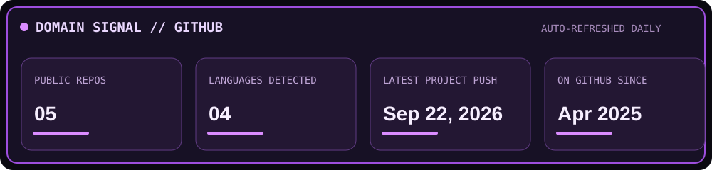
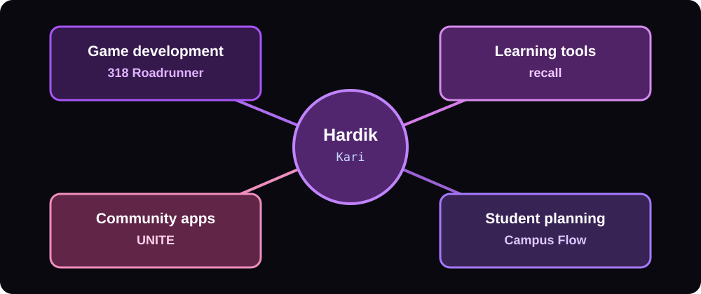
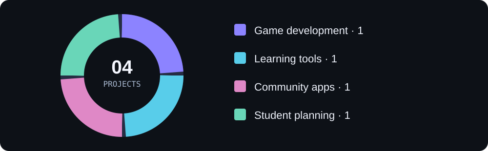

# Welcome to my domain 👋

### Game developer · Security-minded builder · Creative engineer

*Jujutsu Kaisen-inspired visuals. Real projects, real code.*

---

## My domain · About me

<table>
<tr>
<td width="58%" valign="top">

I build software that people can actually use, then look closely at how it behaves under the hood. My public work spans a browser-based study tool, a Java desktop community app, and a Unity endless runner.

- 🎮 **Game development:** systems, feedback, and playful interaction
- 🛡️ **Security mindset:** safer defaults, resilient flows, and careful handling of user data
- 🧩 **Product building:** useful tools with clear interfaces

Right now I'm also working on **Campus Flow**, an early private-beta college planner that organizes schedules, syllabi, deadlines, and study plans.

</td>
<td width="42%" align="center" valign="middle">

</td>
</tr>
</table>

## Power levels · GitHub stats

The stats card is generated from my public repositories by the [profile update workflow](.github/workflows/update-profile.yml). GitHub's full contribution calendar is also available [on my profile](https://github.com/HardikKari#user-activity-overview).

## Domain map · Where my work lives

| Area | Explore |
| :--- | :--- |
| 🎮 Game development | [318 Roadrunner](https://github.com/HardikKari/318-roadrunner) |
| 📚 Learning tools | [recall](https://github.com/HardikKari/recall) · [Play it](https://hardikkari.github.io/recall/) |
| 🗓️ Community software | [UNITE](https://github.com/HardikKari/unite) |
| 🧭 Student planning | Campus Flow · early private beta |

## Featured project mix

Four projects are showcased here, one from each area. This chart groups the featured work; it does not estimate time spent.

## Contribution activity

My [GitHub contribution calendar](https://github.com/HardikKari#user-activity-overview) shows the full activity history. The live feed below highlights my most recently pushed public projects.

## Missions · Featured projects

### 🎮 318 Roadrunner

A three-lane endless runner built with Unity and C#. This is the game-development side of my work: movement, timing, and quick feedback in a playable loop.

[Explore the repository →](https://github.com/HardikKari/318-roadrunner)

### 📚 recall

An offline spaced-repetition flashcard app built with vanilla JavaScript. Create decks, paste or upload notes to generate cards, and review with keyboard controls. Its SM-2 scheduling keeps practice focused, and data stays in your browser without an account.

[Play recall →](https://hardikkari.github.io/recall/) · [Explore the code →](https://github.com/HardikKari/recall)

### 🗓️ UNITE

A JavaFX community calendar for creating, browsing, and RSVPing to local events. It can turn a plain-language event idea into structured details for review before saving. The app uses salted password hashing and remains usable when AI assistance is unavailable.

[Explore the repository →](https://github.com/HardikKari/unite)

### 🧭 Campus Flow

An early private-beta college planner that turns schedules and PDF or DOCX syllabi into an organized semester: courses, deadlines, tasks, study plans, calendar events, and reminders.

## 🧰 My toolkit

| Layer | Tools |
| :--- | :--- |
| Languages | JavaScript, TypeScript, Java, C#, Python |
| Web | React, Next.js, Vite, HTML, CSS |
| Games & desktop | Unity, JavaFX |
| Data & services | Cloudflare Workers, Cloudflare D1, Drizzle ORM |
| Product details | Offline-first interfaces, PWA patterns, PDF and document parsing |

## 📡 Latest builds

Updated daily from public GitHub repositories. Pick a project to inspect what changed recently.

<!-- RECENT_BUILDS_START -->
- [318-roadrunner](https://github.com/HardikKari/318-roadrunner) — A three-lane endless runner built with Unity and C#.
- [recall](https://github.com/HardikKari/recall) — Spaced repetition flashcards in vanilla JavaScript — no framework, no build step. SM-2 scheduling, paste or upload notes to generate decks.
- [unite](https://github.com/HardikKari/unite) — Explore the source code.
<!-- RECENT_BUILDS_END -->

<b>🕹️ Open the mission log</b>

- **Play:** try [recall](https://hardikkari.github.io/recall/) in your browser.
- **Inspect:** browse the source for [318 Roadrunner](https://github.com/HardikKari/318-roadrunner), [recall](https://github.com/HardikKari/recall), or [UNITE](https://github.com/HardikKari/unite).
- **Follow:** see new work on [my GitHub profile](https://github.com/HardikKari).

---

**BUILD · BREAK · LEARN · DEFEND** 
*Domain Expansion: Build Mode*

